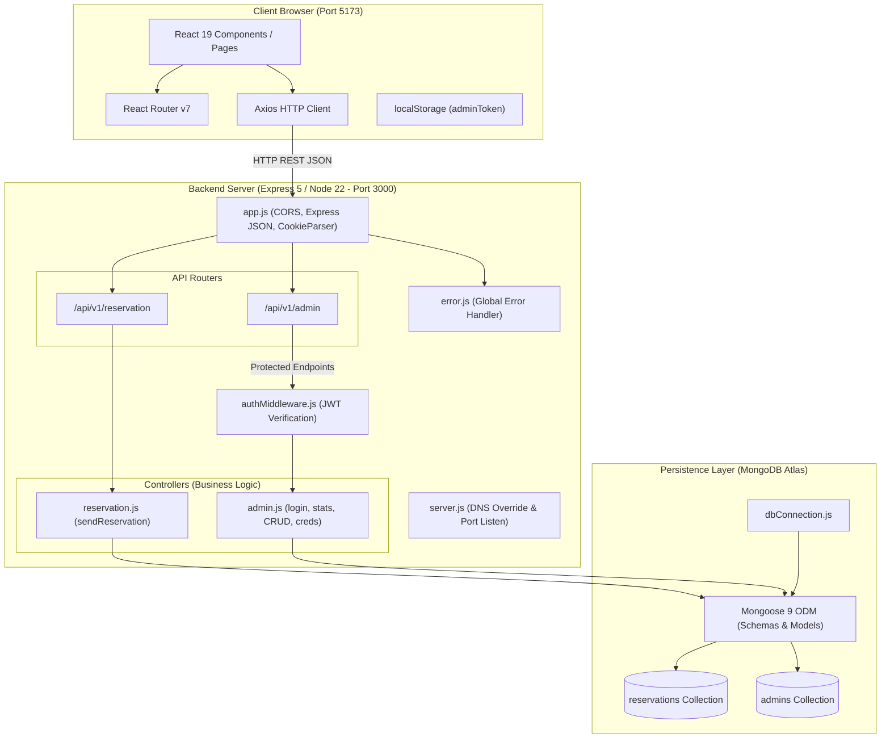

# DT Restro — Comprehensive Project Viva & Interview Documentation

> **Complete Project Guide & Viva Preparation Manual**  
> **Project Name:** DT Restro (DownTown Restaurant & Cafe Management System)  
> **Author & Developer:** Raghvendra Pratap Singh  
> **Architecture:** Modern MERN Stack (MongoDB, Express.js 5, React 19, Node.js 22)  
> **Document Purpose:** Presentation, Viva-Voce, Technical Interviews & Code Defense  

---

## Table of Contents

1. [Project Overview](#1-project-overview)
2. [Features](#2-features)
3. [Technology Stack](#3-technology-stack)
4. [System Architecture](#4-system-architecture)
5. [Project Folder Structure](#5-project-folder-structure)
6. [Frontend Explanation](#6-frontend-explanation)
7. [Backend Explanation](#7-backend-explanation)
8. [Database Explanation](#8-database-explanation)
9. [Code Explanation (Step-by-Step with Code Snippets)](#9-code-explanation)
10. [Application Workflow](#10-application-workflow)
11. [Authentication and Security](#11-authentication-and-security)
12. [API Documentation](#12-api-documentation)
13. [Installation and Execution](#13-installation-and-execution)
14. [Testing and Error Handling](#14-testing-and-error-handling)
15. [Challenges and Solutions](#15-challenges-and-solutions)
16. [Limitations and Future Improvements](#16-limitations-and-future-improvements)
17. [My Contribution](#17-my-contribution)
18. [Project Presentation Script (3–5 Minutes)](#18-project-presentation-script)
19. [Viva Questions and Answers (50+ High-Yield Questions)](#19-viva-questions-and-answers)
20. [Scenario-Based Questions & Answers](#20-scenario-based-questions)
21. [Important Code to Remember for Viva](#21-important-code-to-remember)

---

## 1. Project Overview

### 1.1 Project Name & Brand
- **Project Name:** **DT Restro** (DownTown Restaurant & Cafe)
- **Tagline:** *"Delicious Food, Unforgettable Memories"*
- **Location Context:** Physical restaurant showcase for DownTown Cafe, situated in Hajipur, Bihar, India.

### 1.2 Purpose
DT Restro is a full-stack web application engineered to bridge the gap between dining customers and restaurant operations. It provides an intuitive, high-performance customer-facing portal for exploring menu items and booking table reservations online, paired with an administrative dashboard for restaurant owners and staff to manage, review, filter, and update reservation bookings in real time.

### 1.3 Key Objectives
1. **Eliminate Manual Reservation Bottlenecks:** Replace error-prone manual register books and chaotic phone-call table bookings with an automated, 24/7 web booking engine.
2. **Interactive Digital Culinary Showcase:** Provide an interactive menu with instant search, category filtering (Starters, Main Course, Fast Food, Desserts, Drinks), veg/non-veg tags, and chef badges.
3. **Centralized Administrative Control:** Empower restaurant managers with real-time operational metrics (Total Bookings, Today's Bookings, Upcoming Bookings, Pending, Confirmed, Cancelled).
4. **Enhanced Customer Touchpoints:** Provide floating direct WhatsApp customer communication, smooth single-page navigation, and auto-redirect confirmation pages.
5. **Robust Security & Data Integrity:** Enforce token-based authentication (JWT), secure password hashing (bcryptjs), Mongoose schema validations, and role-restricted admin routes.

### 1.4 Real-World Problem It Solves
- **Problem 1 (Double Booking & Lost Records):** Restaurants relying on manual registers often misplace dates, lose contact numbers, or overbook time slots. DT Restro logs reservations into a cloud database with exact date, time, party size, and customer contacts.
- **Problem 2 (Customer Wait Times & Inconvenience):** Diners often arrive only to find 45-minute queues. With DT Restro, customers reserve ahead and receive clear confirmation statuses.
- **Problem 3 (Unmanaged Walk-ins vs Reservations):** Restaurant managers lack visibility into expected footfall. DT Restro provides daily and upcoming booking counts so kitchen staff can prepare ingredients accordingly.
- **Problem 4 (Static, Outdated Menus):** Printed menus cannot quickly communicate chef specials, dietary indicators (Veg/Non-Veg), or popular dishes. DT Restro provides a responsive digital menu.

---

## 2. Features

### 2.1 Customer-Facing Features
1. **Single-Page Landing Experience (`/`):**
   - **Hero Section:** High-impact banner with restaurant branding, tagline, call-to-action buttons, and culinary imagery.
   - **Smooth Scrolling Navigation:** Navbar uses `react-scroll` to smoothly transition to sections (`About Us`, `Services`, `Team`, `Reservation`).
   - **Brand Story & About Us:** Highlights the philosophy, culinary passion, and restaurant atmosphere.
   - **Quality & Services Highlights:** Cards highlighting *"Quality Food"*, *"Super Taste"*, and *"Fast Delivery"*.
   - **Popular Dishes Carousel/Grid:** Curated showcase of signature dishes directly on the home page.
   - **Who We Are (Metrics & Social Proof):** Dynamic statistical counters showing restaurant milestones (number of restaurants, chefs in kitchen, years of experience, food dishes).
   - **Chef & Team Showcase:** Highlights the culinary artisans (Head Chef, Sous Chef, Fast Food Chef, Senior Chef).
   - **Interactive Table Reservation Form:** Direct form allowing users to select first name, last name, email, phone number, reservation date, time, party size (1–20 guests), and optional special requests.
   - **Modern Footer:** Displays operating hours (05:00 PM – 12:00 AM), contact information, physical address in Hajipur, Bihar, social media links, copyright notice, and discreet link to the Admin portal.
2. **Dedicated Menu Page (`/menu`):**
   - **Live Real-Time Search:** Instant filtering by dish name or ingredient description using client-side memoized search.
   - **Category Tabs:** Fast switching between *All*, *Starters*, *Main Course*, *Fast Food*, *Desserts*, and *Drinks*.
   - **Dietary Indicators:** Color-coded visual badges for Vegetarian (green leaf icon) and Non-Vegetarian (red drumstick icon).
   - **Specialty Badges:** Highlights *"Popular"* dishes with a star badge and *"Chef's Special"* with a gold tag.
   - **Add to Cart Simulation:** Interactive cart button triggering instant toast notifications via `react-hot-toast`.
3. **Reservation Success Page (`/success`):**
   - Displays a celebratory confirmation card.
   - Features an automated 10-second JavaScript countdown interval that redirects the customer safely back to the home page, or allows instant manual return via a button.
4. **404 Not Found Page (`*`):**
   - Catches any undefined URL paths and provides an illustrated 404 message with a direct link back to Home.
5. **Floating WhatsApp Customer Support:**
   - Floating action button in the bottom right corner with pulse hover animation.
   - Directly launches WhatsApp (`https://wa.me/...`) with a pre-configured greeting message for takeout orders or customer questions.

### 2.2 Administrative & Operational Features
1. **Owner/Admin Authentication Portal (`/admin/login`):**
   - Dedicated login card for authorized personnel with custom DT Restro branding.
   - Authenticates via Admin ID or Email and password.
   - Stores JWT token in `localStorage` and establishes secure HTTP-only cookies.
   - Prevents unauthenticated access; automatically redirects authenticated users directly to the dashboard.
2. **Protected Route Architecture (`AdminProtectedRoute`):**
   - Wraps administrative components to verify authentication state before rendering. Redirects unauthorized attempts to `/admin/login`.
3. **Live Analytical Dashboard (`/admin/dashboard`):**
   - **Real-Time Stat Cards:**
     - *Total Bookings* (Cumulative reservations count)
     - *Today's Bookings* (Reservations matching the current calendar date)
     - *Upcoming Bookings* (Future active reservations)
     - *Pending* (Bookings awaiting staff approval)
     - *Confirmed* (Approved reservations)
     - *Cancelled* (Rejected or customer-cancelled bookings)
   - **Recent Reservations Quick-View:** Instant preview of the latest 5 bookings on the dashboard home.
4. **Comprehensive Reservations Management Table:**
   - Displays customer name, avatar initial, email, phone, booking date, time slot, guest count, and current status.
   - **Search Filter:** Live search filtering across customer name, phone number, or email.
   - **Status Filter Dropdown:** Filter by *All*, *Pending*, *Confirmed*, or *Cancelled*.
   - **Date Picker Filter:** Filter reservations for any specific day.
   - **Inline Status Modification:** Update status directly from table dropdown with immediate optimistic UI update.
5. **Detailed Reservation Modal:**
   - Full-screen modal pop-up displaying deep reservation metadata: full customer details, party size, booking timestamp, and special requests/instructions (e.g., birthday arrangements, window seat).
6. **Reservation Deletion:**
   - Permanent removal of cancelled or stale reservation records with browser confirmation prompt.
7. **Credentials & Security Management:**
   - Dedicated tab in Admin Dashboard allowing the owner to change their **Admin ID** and/or **Password**.
   - Requires verification of the current password before applying changes.
   - Enforces length validations and re-hashes new passwords via bcrypt before persisting.
8. **Automated Admin Initialization:**
   - Server automatically initializes the owner admin account upon database startup using environment variables (`ADMIN_ID`, `ADMIN_PASSWORD`) if no admin exists.
   - Standalone interactive CLI script (`npm run create-admin`) for emergency credential resets from the terminal.

---

## 3. Technology Stack

### 3.1 Frontend Technologies
| Technology | Version | Purpose in DT Restro | Why It Was Chosen |
|---|---|---|---|
| **React** | `^19.2.0` | Core UI library for component-driven architecture | Declarative UI, virtual DOM rendering, hooks (`useState`, `useEffect`, `useMemo`, `useCallback`) for clean state management. |
| **Vite** | `^7.3.1` | Next-generation frontend build tool and dev server | Instant Hot Module Replacement (HMR), lightning-fast ES-build bundling, superior developer experience compared to Webpack. |
| **React Router DOM** | `^7.13.0` | Client-side routing library | Enables seamless navigation across `/`, `/menu`, `/success`, `/admin/login`, `/admin/dashboard`, and 404 without full page reloads. |
| **Axios** | `^1.13.5` | Promise-based HTTP client | Simplified asynchronous requests, automatic JSON transformation, easy interceptors, and built-in cookie support (`withCredentials: true`). |
| **React Hot Toast** | `^2.6.0` | Lightweight notification library | Elegant, customizable popup alerts for successful reservations, cart actions, login feedback, and error messages. |
| **React Icons** | `^5.5.0` | Iconography suite | Provides clean vector icons from FontAwesome (`fa`), Material Design (`md`), Heroicons (`hi`), and Game Icons (`gi`). |
| **React Scroll** | `^1.9.3` | Smooth scrolling library | Enables smooth scrolling transitions to section anchors on the home page when clicking navbar links. |
| **Vanilla CSS** | CSS3 | Custom design system & responsiveness | Maximum flexibility, custom design tokens (`:root` variables), glassmorphism, responsive grid/flexbox, zero framework bloat. |

### 3.2 Backend Technologies
| Technology | Version | Purpose in DT Restro | Why It Was Chosen |
|---|---|---|---|
| **Node.js** | `v22.x` | JavaScript runtime environment | Non-blocking, event-driven I/O model ideal for concurrent API requests. Enables unified JS across frontend and backend. |
| **Express.js** | `^5.2.1` | Web application backend framework | Minimalist, robust HTTP server. Express 5 brings enhanced promise error handling, cleaner routing, and modern standards. |
| **MongoDB Atlas** | Cloud DB | NoSQL document database | Schema-flexible JSON-like documents, high availability, cloud clustering, and native geospatial/indexing capabilities. |
| **Mongoose** | `^9.2.1` | Object Data Modeling (ODM) library | Enforces strict schemas, validation rules, pre-save middleware hooks, type safety, and clean async query methods. |
| **JSON Web Token (JWT)** | `^9.0.3` | Stateless authentication tokens | Encodes admin ID into a digitally signed token (`jwt.sign`/`jwt.verify`) with expiration, eliminating server-side session overhead. |
| **bcryptjs** | `^3.0.3` | Cryptographic password hashing | Uses one-way adaptive hashing with 10 salt rounds to secure admin passwords against brute-force and rainbow table attacks. |
| **Cookie-Parser** | `^1.4.7` | Cookie parsing middleware | Parses `Cookie` HTTP headers and populates `req.cookies` to read secure HTTP-only admin session cookies. |
| **CORS** | `^2.8.6` | Cross-Origin Resource Sharing | Enables controlled cross-origin HTTP communication between the Vite frontend (port 5173) and Express backend (port 3000). |
| **Validator** | `^13.15.26` | String validation library | Provides robust email validation (`validator.isEmail`) in Mongoose schemas. |
| **Dotenv** | `^17.3.1` | Environment variable management | Loads secret keys, database credentials, and port numbers from `.env` files into `process.env`. |
| **Nodemon** | `^3.1.13` | Development utility | Automatically restarts the Node server upon file modifications during development. |

---

## 4. System Architecture

### 4.1 Architectural Pattern: 3-Tier Client-Server Architecture
DT Restro is designed following the industry-standard **3-Tier Architecture**:
1. **Presentation Layer (Frontend):** React 19 application running in the user's browser, responsible for rendering views, capturing inputs, client-side routing, and triggering HTTP calls.
2. **Application / Business Logic Layer (Backend):** Express 5 REST API running on Node.js 22, responsible for request parsing, CORS policy enforcement, route handling, input validation, JWT verification, and business logic execution.
3. **Data Access / Persistence Layer (Database):** MongoDB Atlas cloud cluster managed through Mongoose 9 ODM, responsible for data persistence, schema enforcement, indexing, and transactional operations.

### 4.2 Architecture Communication Flow Diagram



### 4.3 DNS Resilience Architecture
On Windows workstations and certain ISP routers, MongoDB Atlas SRV connection strings (`mongodb+srv://...`) often experience DNS timeout failures. DT Restro implements an architectural safeguard in `server.js` and `dbConnection.js`:
```javascript
import dns from "node:dns";
try {
  dns.setServers(["8.8.8.8", "1.1.1.1"]); // Google and Cloudflare Public DNS
} catch (e) {}
```
This forces the Node runtime to resolve MongoDB Atlas cluster hosts via reliable public DNS resolvers, guaranteeing uninterrupted database connectivity.

---

## 5. Project Folder Structure

```
DTrestro-main/
│
├── Backend/                            # Node.js & Express.js Backend Application
│   ├── config/
│   │   ├── config.env                 # Active environment variables (PORT, MONGO_URL, JWT_SECRET, etc.)
│   │   └── config.env.example         # Template for environment configuration
│   ├── controller/
│   │   ├── admin.js                   # Business logic for admin login, stats, reservation updates & credentials
│   │   └── reservation.js             # Business logic for creating customer table reservations
│   ├── database/
│   │   └── dbConnection.js            # Mongoose connection logic with DNS fallback and admin auto-init
│   ├── error/
│   │   └── error.js                   # Custom Errorhandler class and global Express error middleware
│   ├── middleware/
│   │   └── authMiddleware.js          # JWT authentication middleware for protected admin routes
│   ├── models/
│   │   ├── adminSchema.js             # Mongoose schema for Admin accounts (bcrypt pre-save hook, JWT method)
│   │   └── reservationSchema.js       # Mongoose schema for Reservations (validation rules, enum statuses)
│   ├── routes/
│   │   ├── adminRoute.js              # Express routing definitions for admin endpoints
│   │   └── reservationRoute.js        # Express routing definitions for reservation endpoints
│   ├── scripts/
│   │   ├── createAdmin.js             # Standalone interactive CLI script to create/reset admin credentials
│   │   └── initAdmin.js               # Auto-initialization script invoked during database connection
│   ├── app.js                         # Express app configuration, CORS, parsers, route mounting, error handler
│   ├── package.json                   # Backend dependencies, metadata, and scripts (start, dev, create-admin)
│   └── server.js                      # Application entry point: sets DNS servers and starts HTTP listener
│
├── Frontend/                           # React 19 & Vite Frontend Application
│   ├── public/                        # Static public assets (images, SVGs, logos, food photos)
│   │   ├── about.png, dinner1.jpeg, lunch1.png, menu.jpg, logoDT.png, etc.
│   ├── src/
│   │   ├── components/                # Reusable UI Components
│   │   │   ├── About.jsx              # About Us story and philosophy section
│   │   │   ├── AdminProtectedRoute.jsx# Route wrapper guarding dashboard from unauthenticated users
│   │   │   ├── Footer.jsx             # Site footer with contacts, hours, social links & admin link
│   │   │   ├── HeroSection.jsx        # Landing hero banner with brand typography & dishes
│   │   │   ├── Menu.jsx               # Popular dishes preview section on home page
│   │   │   ├── Navbar.jsx             # Top navigation bar with logo, react-scroll links & menu button
│   │   │   ├── Qualities.jsx          # Feature cards (Quality Food, Super Taste, Fast Delivery)
│   │   │   ├── Reservation.jsx        # Customer table reservation form with real-time submission
│   │   │   ├── Team.jsx               # Restaurant chef and culinary team cards
│   │   │   ├── WhatsAppButton.jsx     # Floating WhatsApp action button with tooltip
│   │   │   └── WhoAreWe.jsx           # Statistical counter showcase section
│   │   ├── pages/                     # Full Page Views
│   │   │   ├── AdminDashboard.jsx     # Comprehensive admin management panel (stats, table, modal, credentials)
│   │   │   ├── AdminLogin.jsx         # Authorized admin login page
│   │   │   ├── Home.jsx               # Main landing page combining all home components
│   │   │   ├── MenuPage.jsx           # Dedicated interactive menu with search & category filtering
│   │   │   ├── NotFound.jsx           # 404 error page with redirect to home
│   │   │   └── Success.jsx            # Reservation confirmation page with 10s auto-countdown
│   │   ├── App.css                    # Global application styles, design tokens, responsive breakpoints
│   │   ├── App.jsx                    # Root React component defining routes, Toaster & WhatsApp widget
│   │   ├── config.js                  # Dynamic backend API URL configuration
│   │   ├── index.css                  # Base reset stylesheet
│   │   ├── main.jsx                   # React DOM application mount point
│   │   ├── menuData.js                # Structured menu items database with pricing, veg tags, badges
│   │   └── restApi.json               # Static content repository (team, qualities, counters, popular dishes)
│   ├── .env                           # Frontend environment variables (VITE_BACKEND_URL)
│   ├── .env.example                   # Template for frontend environment variables
│   ├── index.html                     # HTML5 entry page with viewport meta tags and title
│   ├── package.json                   # Frontend dependencies, build scripts (dev, build, preview)
│   └── vite.config.js                 # Vite bundler configuration with React plugin
│
├── .gitignore                         # Git exclusion rules (node_modules, .env, dist)
├── PROJECT_VIVA_DOCUMENTATION.md      # This complete documentation and viva preparation manual
├── PROJECT_VIVA_DOCUMENTATION.pdf     # Downloadable print-ready PDF version
└── README.md                          # Repository overview and setup manual
```

---

## 6. Frontend Explanation

### 6.1 Routing Architecture (`Frontend/src/App.jsx`)
`App.jsx` serves as the root component wrapping the application with React Router DOM's `<BrowserRouter>`, `<Routes>`, and `<Route>`. It also mounts global singletons: `<Toaster position="top-right" />` and `<WhatsAppButton />`.

- **Route Configuration:**
  - `/` $\rightarrow$ `<Home />` (Customer landing page)
  - `/menu` $\rightarrow$ `<MenuPage />` (Full culinary catalog with search)
  - `/success` $\rightarrow$ `<Success />` (Reservation booking confirmation)
  - `/admin/login` $\rightarrow$ `<AdminLogin />` (Admin authentication portal)
  - `/admin/dashboard` $\rightarrow$ `<AdminProtectedRoute><AdminDashboard /></AdminProtectedRoute>` (Protected admin operations)
  - `*` $\rightarrow$ `<NotFound />` (Fallback 404 catch-all)

### 6.2 Component Deep-Dive

#### 1. `Navbar.jsx`
- **Purpose:** Top branding and navigation bar.
- **Key Functions & Logic:**
  - Manages mobile drawer toggle via `const [show, setShow] = useState(false)`.
  - Uses `react-scroll`'s `<Link to="..." spy={true} smooth={true} duration={500}>` to enable animated scrolling to sections (`heroSection`, `about`, `qualities`, `team`, `reservation`).
  - Includes a prominent button that navigates directly to `/menu` via React Router's `useNavigate()`.
  - Includes hamburger icon toggle for responsive mobile screen widths.

#### 2. `HeroSection.jsx`
- **Purpose:** Above-the-fold visual impact section.
- **Key Elements:** Displays bold typography (*"Delicious Food Dishes"*), culinary graphics (`hero1.png`, `hero2.png`, `threelines.svg`), and encapsulates the top `<Navbar />`.

#### 3. `About.jsx`
- **Purpose:** Introduces the restaurant's philosophy and heritage.
- **Key Elements:** Engaging copy explaining fresh ingredients, an interior restaurant visual (`about.png`), and a call-to-action button linking to `/menu`.

#### 4. `Qualities.jsx`
- **Purpose:** Displays service pillars.
- **Data Source:** Maps over `data[0].ourQualities` from `restApi.json`.
- **Items:** Quality Food (fresh ingredients), Super Taste (skilled chefs), and Fast Delivery (carefully packaged hot delivery).

#### 5. `Menu.jsx`
- **Purpose:** Home page preview of popular signature dishes.
- **Data Source:** Maps over `data[0].dishes` from `restApi.json` displaying items such as *Roasted Lamb Rump*, *Citrus Cured Salmon*, and *Italian Spaghetti*.

#### 6. `WhoAreWe.jsx`
- **Purpose:** Social proof and restaurant scale metrics.
- **Data Source:** Splits `data[0].who_we_are` into two banners surrounding a center graphic (`center.svg` and `whoweare.png`).
- **Counters Displayed:** 14 Restaurants, 20 Chefs in Kitchen, 08 Years of Experience, 200 Food Dishes.

#### 7. `Team.jsx`
- **Purpose:** Highlights key culinary staff.
- **Data Source:** Maps over `data[0].team` displaying portrait photos, names, and titles (Founder & Head Chef, Sous Chef, Fast Food Chef, Senior Chef).

#### 8. `Reservation.jsx`
- **Purpose:** Interactive customer table booking form.
- **State Fields:** `firstName`, `lastName`, `email`, `date`, `time`, `phone`, `guests` (default 1), `specialMessage`.
- **Submission Handler (`handleReservation`):**
  - Prevents default form submission (`e.preventDefault()`).
  - Dispatches an asynchronous `axios.post` request to `${BACKEND_URL}/api/v1/reservation/send`.
  - On HTTP 200 response: Displays success toast, resets form state fields, and navigates to `/success`.
  - On error: Intercepts `error.response?.data?.message` and displays an informative error toast.

#### 9. `Footer.jsx`
- **Purpose:** Comprehensive website closing element.
- **Elements:** Restaurant identity, operating schedule (05:00 PM – 12:00 AM), contact numbers, physical location in Hajipur, Bihar, social media links, copyright credit to *Raghvendra Pratap Singh*, and a subtle link to `/admin/login`.

#### 10. `WhatsAppButton.jsx`
- **Purpose:** Floating real-time customer engagement tool.
- **Logic:** Renders a fixed-position SVG button linked to `https://wa.me/548658665866?text=Hello!%20%F0%9F%91%8B`. Hover state reveals a *"Chat on WhatsApp"* tooltip.

#### 11. `AdminProtectedRoute.jsx`
- **Purpose:** Client-side route security boundary.
- **Logic:** Checks `localStorage.getItem("adminToken")`. If absent, immediately returns `<Navigate to="/admin/login" replace />`. If present, renders the protected child component (`AdminDashboard`).

### 6.3 Page Deep-Dive

#### 1. `MenuPage.jsx`
- **Purpose:** Dedicated full-featured culinary explorer.
- **Key States:**
  - `activeCategory` (default `"All"`): Tracks active category tab.
  - `searchQuery`: Captures live user typing in the search bar.
- **Performance Optimization (`useMemo`):**
  ```javascript
  const filtered = useMemo(() => {
    return menuData.filter((item) => {
      const matchesCategory =
        activeCategory === "All" || item.category === activeCategory;
      const matchesSearch =
        item.name.toLowerCase().includes(searchQuery.toLowerCase()) ||
        item.desc.toLowerCase().includes(searchQuery.toLowerCase());
      return matchesCategory && matchesSearch;
    });
  }, [activeCategory, searchQuery]);
  ```
  Prevents recalculating the filter array on unrelated renders.
- **Interactive Badges:** Helper sub-components `<VegIcon isVeg={item.isVeg} />` and `<Badge label={item.badge} />`.
- **Add to Cart Interaction:** Simulates adding items with a celebratory toast notification.

#### 2. `Success.jsx`
- **Purpose:** Reservation completion screen.
- **Logic:** Sets a 1-second `setInterval` decrementing `countdown` from 10 to 0. When it hits 1, clears interval and calls `navigate("/")`.

#### 3. `AdminLogin.jsx`
- **Purpose:** Secure portal for restaurant owners.
- **Key States:** `adminId`, `loginPassword`, `loginLoading`.
- **Authentication Handler (`handleLogin`):**
  - Sends POST request to `/api/v1/admin/login` with `withCredentials: true`.
  - Persists `data.token`, `data.admin.adminId`, and `data.admin.name` into `localStorage`.
  - Displays welcome toast and redirects to `/admin/dashboard`.

#### 4. `AdminDashboard.jsx`
- **Purpose:** Central operational headquarters.
- **Key Capabilities:**
  - **Metrics Fetching (`fetchStats`):** Retrieves cumulative, today's, upcoming, pending, confirmed, and cancelled counts.
  - **Reservations Fetching (`fetchReservations`):** Requests list with query parameters `?status=...&date=...&search=...`.
  - **Debounced Search:** Implements a 400ms `setTimeout` debounce on `searchInput` to prevent excessive API requests.
  - **Status Transition (`updateStatus`):** Dispatches PUT request to update status to `Confirmed`, `Cancelled`, or `Pending`.
  - **Record Deletion (`deleteReservation`):** Requests DELETE to remove unwanted entries.
  - **Modal Inspector (`ReservationModal`):** Shows complete customer requests in a focused overlay.
  - **Credentials Management Tab:** Allows updating Admin ID and password after verifying current credentials.

---

## 7. Backend Explanation

### 7.1 Server Entry Point (`Backend/server.js`)
- Initializes public DNS resolvers (`8.8.8.8`, `1.1.1.1`) to prevent Atlas connection drops.
- Imports configured Express application from `app.js`.
- Binds server to `process.env.PORT` (defaults to 3000) and prints confirmation to console.

### 7.2 Express App Setup (`Backend/app.js`)
- Loads environment configuration via `dotenv.config({ path: "./config/config.env" })`.
- Mounts **CORS Middleware** configured with dynamic allowed origin (`FRONTEND_URL` or `http://localhost:5173`), allowed HTTP methods (`GET`, `POST`, `PUT`, `DELETE`), and `credentials: true`.
- Mounts `cookieParser()` for extracting cookies.
- Mounts `express.json()` and `express.urlencoded({ extended: true })` body parsers.
- Establishes MongoDB database connection via `dbConnection()`.
- Mounts API route handlers:
  - `/api/v1/reservation` $\rightarrow$ `reservationRouter`
  - `/api/v1/admin` $\rightarrow$ `adminRouter`
- Mounts global `errorMiddleware` as the final middleware in the stack.

### 7.3 Database Connector (`Backend/database/dbConnection.js`)
- Connects Mongoose to `process.env.MONGO_URL` targeting database `"dtrestro"`.
- Upon successful connection, invokes `initAdminAccount()` to verify or seed the authorized admin user.

### 7.4 Authentication Middleware (`Backend/middleware/authMiddleware.js`)
Protects private admin endpoints using a multi-source token inspection strategy:
1. **Header Inspection:** Checks `req.headers.authorization` for a `Bearer <token>` format.
2. **Cookie Fallback:** If absent in headers, checks `req.cookies.adminToken`.
3. If no token is detected: Returns HTTP 401 (`"Not authorised. Please log in."`).
4. **Token Verification:** Calls `jwt.verify(token, process.env.JWT_SECRET)`.
5. **Admin Lookup:** Queries `Admin.findById(decoded.id)`. Attaches retrieved admin document to `req.admin` and calls `next()`.

### 7.5 Centralized Error Handling (`Backend/error/error.js`)
- **`Errorhandler` Class:** Subclasses native JavaScript `Error` by appending a `statusCode` property:
  ```javascript
  class Errorhandler extends Error {
    constructor(message, statusCode){
      super(message);
      this.statusCode = statusCode;
    }
  }
  ```
- **`errorMiddleware`:** Catches all errors forwarded via `next(err)`:
  - Defaults fallback message to `"Internal Server Error!"` and status code to `500`.
  - Responds with uniform JSON: `{ success: false, message: err.message }`.

### 7.6 Controller Logic

#### 1. Reservation Controller (`Backend/controller/reservation.js`)
- **`sendReservation`:**
  - Extracts `firstName`, `lastName`, `email`, `phone`, `date`, `time`, `guests`, and `specialMessage` from `req.body`.
  - Validates that mandatory fields are present. If missing, forwards `new Errorhandler("Please fill full reservation form!", 400)`.
  - Executes `Reservation.create(...)` with default status `"Pending"`.
  - Catches Mongoose `ValidationError` (e.g. invalid email format or name length bounds), maps validation error strings, and returns HTTP 400.

#### 2. Admin Controller (`Backend/controller/admin.js`)
- **`loginAdmin`:** Validates input $\rightarrow$ finds admin document by `adminId` or `email` with `.select("+password")` $\rightarrow$ compares entered password with hashed password via `admin.comparePassword(password)` $\rightarrow$ generates JWT token via `admin.generateToken()` $\rightarrow$ sets HTTP-only cookie $\rightarrow$ returns JSON containing token and admin details.
- **`checkSetup`:** Returns `{ success: true, adminExists: true, registrationOpen: false }`.
- **`registerAdmin`:** Permanently disabled for security; immediately returns HTTP 403 Forbidden.
- **`getAdminProfile`:** Returns current logged-in admin data attached to `req.admin`.
- **`changeAdminCredentials`:** Verifies current password $\rightarrow$ updates `adminId` (ensuring uniqueness) and/or updates `password` $\rightarrow$ saves document (triggering bcrypt pre-save hash) $\rightarrow$ issues fresh JWT token and cookie.
- **`logoutAdmin`:** Clears `adminToken` cookie and returns HTTP 200.
- **`getAllReservations`:** Queries `Reservation` with dynamic filters (`status`, `date`, and regex search on name, phone, email) sorted by `createdAt: -1`.
- **`getDashboardStats`:** Runs parallel aggregation queries via `Promise.all` using `Reservation.countDocuments()` to compute Total, Today's, Upcoming, Pending, Confirmed, and Cancelled counts.
- **`updateReservationStatus`:** Validates that status is one of `["Pending", "Confirmed", "Cancelled"]` $\rightarrow$ runs `findByIdAndUpdate` with `runValidators: true`.
- **`deleteReservation`:** Finds and deletes reservation document by `req.params.id`.
- **`getSingleReservation`:** Retrieves a single reservation document by ID.

---

## 8. Database Explanation

### 8.1 Database Engine
- **Database System:** MongoDB (Document-Oriented NoSQL)
- **Database Name:** `dtrestro`
- **Hosting:** MongoDB Atlas (Cloud Cluster)

### 8.2 Collections & Schemas

#### Collection 1: `reservations`
Stores every customer table booking request.

| Field Name | BSON Data Type | Validation Rules / Constraints | Default Value | Description |
|---|---|---|---|---|
| `_id` | `ObjectId` | Auto-generated unique identifier | Auto | Primary key of the reservation document |
| `firstName` | `String` | `required: true`, minLength: 3, maxLength: 30 | None | Customer's first name |
| `lastName` | `String` | `required: true`, minLength: 3, maxLength: 30 | None | Customer's last name |
| `email` | `String` | `required: true`, validated via `validator.isEmail` | None | Customer's email address |
| `phone` | `String` | `required: true`, minLength: 10, maxLength: 15 | None | Customer's contact phone number |
| `date` | `String` | `required: true` (Stored as YYYY-MM-DD string) | None | Date of dining reservation |
| `time` | `String` | `required: true` (e.g., "19:30" or "07:30 PM") | None | Time slot requested |
| `guests` | `Number` | `min: 1`, `max: 20` | `1` | Number of dining guests |
| `specialMessage`| `String` | `maxLength: 300` | `""` | Optional customer notes/requests |
| `status` | `String` | `enum: ["Pending", "Confirmed", "Cancelled"]` | `"Pending"` | Current status of the reservation |
| `createdAt` | `Date` | Timestamp (auto-managed via `{ timestamps: true }`) | Current Time | Record creation timestamp |
| `updatedAt` | `Date` | Timestamp (auto-managed via `{ timestamps: true }`) | Current Time | Last record update timestamp |

#### Collection 2: `admins`
Stores authorized administrator accounts.

| Field Name | BSON Data Type | Validation Rules / Constraints | Default Value | Description |
|---|---|---|---|---|
| `_id` | `ObjectId` | Auto-generated unique identifier | Auto | Primary key of the admin record |
| `adminId` | `String` | `required: true`, `unique: true`, `trim: true` | None | Unique login identifier chosen by owner |
| `name` | `String` | `trim: true` | `"Admin"` | Display name of the admin |
| `email` | `String` | `trim: true` | None | Optional recovery/contact email |
| `password` | `String` | `required: true`, `minLength: 6`, `select: false` | None | Hashed password string (bcrypt) |
| `createdAt` | `Date` | Timestamp (auto-managed via `{ timestamps: true }`) | Current Time | Account creation timestamp |
| `updatedAt` | `Date` | Timestamp (auto-managed via `{ timestamps: true }`) | Current Time | Account modification timestamp |

### 8.3 Data Lifecycle Operations (CRUD Implementation)
- **Create (Insert):**
  - Reservations: `Reservation.create({ firstName, lastName, email, phone, date, time, guests, specialMessage, status: "Pending" })`
  - Admin: `new Admin({ adminId, name, email, password }).save()`
- **Read (Retrieve):**
  - List with Filters: `Reservation.find(query).sort({ createdAt: -1 })`
  - Dashboard Metrics: `Reservation.countDocuments({ status: "Pending" })`
  - Admin Profile: `Admin.findById(decoded.id)`
  - Admin Authentication: `Admin.findOne({ $or: [{ adminId: inputId }, { email: inputId }] }).select("+password")`
- **Update (Modify):**
  - Status Update: `Reservation.findByIdAndUpdate(id, { status }, { new: true, runValidators: true })`
  - Credential Change: `admin.save()` (triggers pre-save hashing if password was modified)
- **Delete (Remove):**
  - Reservation Purge: `Reservation.findByIdAndDelete(req.params.id)`

---

## 9. Code Explanation

### 9.1 Password Hashing & JWT Generation in Mongoose Schema
**File:** `Backend/models/adminSchema.js`
```javascript
// Hash password before saving (Mongoose 9 style: no next() in async hooks)
adminSchema.pre("save", async function () {
  if (!this.isModified("password")) return;
  this.password = await bcrypt.hash(this.password, 10);
});

// Compare password
adminSchema.methods.comparePassword = async function (enteredPassword) {
  return await bcrypt.compare(enteredPassword, this.password);
};

// Generate JWT token
adminSchema.methods.generateToken = function () {
  return jwt.sign(
    { id: this._id, adminId: this.adminId },
    process.env.JWT_SECRET,
    {
      expiresIn: process.env.JWT_EXPIRES || "7d",
    }
  );
};
```
- **Step-by-Step Logic:**
  1. `adminSchema.pre("save", ...)`: Intercepts document saves. In Mongoose 9, async hooks return a promise and do not use a `next()` callback.
  2. `if (!this.isModified("password")) return;`: Prevents re-hashing an already-hashed password if only the `name` or `adminId` was modified.
  3. `bcrypt.hash(this.password, 10)`: Generates a cryptographically strong salt with cost factor 10 and hashes the plaintext password.
  4. `comparePassword`: Uses `bcrypt.compare` to compare the entered plaintext string with the stored hash.
  5. `generateToken`: Signs a JSON Web Token payload containing the document `_id` and `adminId` using the private `JWT_SECRET` key, expiring in 7 days.

---

### 9.2 JWT Authentication Middleware
**File:** `Backend/middleware/authMiddleware.js`
```javascript
export const isAdminAuthenticated = async (req, res, next) => {
  let token;

  if (
    req.headers.authorization &&
    req.headers.authorization.startsWith("Bearer ")
  ) {
    token = req.headers.authorization.split(" ")[1];
  } else if (req.cookies && req.cookies.adminToken) {
    token = req.cookies.adminToken;
  }

  if (!token) {
    return res.status(401).json({ success: false, message: "Not authorised. Please log in." });
  }

  try {
    const decoded = jwt.verify(token, process.env.JWT_SECRET);
    req.admin = await Admin.findById(decoded.id);
    if (!req.admin) {
      return res.status(401).json({ success: false, message: "Admin not found." });
    }
    next();
  } catch (err) {
    return res.status(401).json({ success: false, message: "Token is invalid or expired." });
  }
};
```
- **Step-by-Step Logic:**
  1. Checks if the incoming HTTP request has an `Authorization` header starting with `"Bearer "`. If so, extracts the token string.
  2. If missing, checks `req.cookies.adminToken` (populated by `cookie-parser`).
  3. If no token exists, immediately rejects the request with HTTP 401 Unauthorized.
  4. Calls `jwt.verify()` with `process.env.JWT_SECRET`. If expired or tampered, throws an exception caught by `catch (err)`.
  5. Looks up the admin record by ID in MongoDB. If found, attaches it to `req.admin` and calls `next()` to pass control to the route controller.

---

### 9.3 Client-Side Route Protection
**File:** `Frontend/src/components/AdminProtectedRoute.jsx`
```javascript
import React from "react";
import { Navigate } from "react-router-dom";

const AdminProtectedRoute = ({ children }) => {
  const token = localStorage.getItem("adminToken");
  if (!token) {
    return <Navigate to="/admin/login" replace />;
  }
  return children;
};

export default AdminProtectedRoute;
```
- **Step-by-Step Logic:**
  1. Inspects browser `localStorage` for the key `"adminToken"`.
  2. If the token is missing, returns React Router's `<Navigate>` component with `replace={true}`, redirecting the unauthorized visitor straight to the login screen.
  3. If the token exists, renders the protected `children` component (`AdminDashboard`).

---

### 9.4 Fast In-Memory Menu Search & Category Filtering
**File:** `Frontend/src/pages/MenuPage.jsx`
```javascript
const filtered = useMemo(() => {
  return menuData.filter((item) => {
    const matchesCategory =
      activeCategory === "All" || item.category === activeCategory;
    const matchesSearch =
      item.name.toLowerCase().includes(searchQuery.toLowerCase()) ||
      item.desc.toLowerCase().includes(searchQuery.toLowerCase());
    return matchesCategory && matchesSearch;
  });
}, [activeCategory, searchQuery]);
```
- **Step-by-Step Logic:**
  1. Utilizes React's `useMemo` hook to cache the filtered array of menu items.
  2. `matchesCategory`: Checks if the active tab is `"All"` or matches the item's `category`.
  3. `matchesSearch`: Converts user search text and dish name/description to lowercase and performs a substring check.
  4. Recalculation occurs *only* when `activeCategory` or `searchQuery` changes, keeping rendering smooth.

---

### 9.5 Debounced Search & Live Filtering in Admin Dashboard
**File:** `Frontend/src/pages/AdminDashboard.jsx`
```javascript
// Search debounce
const [searchInput, setSearchInput] = useState("");
useEffect(() => {
  const t = setTimeout(() => setSearch(searchInput), 400);
  return () => clearTimeout(t);
}, [searchInput]);
```
- **Step-by-Step Logic:**
  1. `searchInput` binds to the HTML `<input>` tag to reflect instantaneous typing.
  2. The `useEffect` sets a timer for 400 milliseconds before updating the actual query state `search`.
  3. If the user types another character within 400ms, the cleanup function `clearTimeout(t)` cancels the previous timer.
  4. This prevents making an API request on every keystroke, dramatically reducing server load.

---

## 10. Application Workflow

### 10.1 Customer Table Reservation Journey
```
1. Customer visits http://localhost:5173/
   │
2. Scrolls to "Book Your Table" (or clicks "RESERVATION" in Navbar)
   │
3. Fills in First Name, Last Name, Email, Phone, Date, Time, Guests, Special Request
   │
4. Clicks "RESERVE NOW" button
   │
5. Axios sends POST /api/v1/reservation/send with JSON payload
   │
6. Express Backend validates required fields & schema rules
   │
7. Mongoose inserts document into "reservations" collection with status: "Pending"
   │
8. Backend returns { success: true, message: "Reservation Sent Successfully!" }
   │
9. React displays toast alert & navigates customer to /success
   │
10. Success page displays 10-second countdown timer and auto-redirects back to Home
```

### 10.2 Admin Login & Session Management Journey
```
1. Admin visits http://localhost:5173/admin/login (or clicks "🔐 Admin" in footer)
   │
2. Admin enters Admin ID and Password, clicks "Sign In →"
   │
3. Frontend sends POST /api/v1/admin/login with credentials & withCredentials: true
   │
4. Backend finds Admin record by adminId, compares bcrypt password hash
   │
5. If valid, Backend signs JWT token & sets HTTP-only cookie "adminToken"
   │
6. Backend returns { success: true, token, admin: { adminId, name, email } }
   │
7. Frontend stores token & admin details in localStorage
   │
8. Frontend redirects user to /admin/dashboard
   │
9. AdminProtectedRoute verifies token presence and renders AdminDashboard
   │
10. Dashboard useEffect triggers fetchStats() and fetchReservations() with Authorization header
```

### 10.3 Admin Reservation Status Update Journey
```
1. Admin opens Reservations Table on /admin/dashboard
   │
2. Admin changes status dropdown for a booking from "Pending" to "Confirmed"
   │
3. Frontend sends PUT /api/v1/admin/reservations/:id/status with { status: "Confirmed" }
   │
4. authMiddleware verifies JWT token from Authorization header
   │
5. Controller updates document in MongoDB via findByIdAndUpdate
   │
6. Backend returns { success: true, message: "Status updated to Confirmed" }
   │
7. Frontend shows success toast, refreshes dashboard metrics & updates table row badge
```

---

## 11. Authentication and Security

### 11.1 Security Measures Actually Implemented in the Codebase

1. **Cryptographic Password Storage (Bcrypt):**
   - Passwords are never stored as plaintext.
   - Hashed using `bcryptjs` with salt rounds = 10 via Mongoose pre-save hook.
2. **Defensive Password Projection (`select: false`):**
   - The `password` field in `adminSchema` has `select: false`. Normal database queries (`Admin.find()` or `Admin.findById()`) will never accidentally leak the password hash in HTTP responses.
   - It is only selected explicitly when verifying login credentials (`.select("+password")`).
3. **Stateless JWT Tokens with Expiration:**
   - Tokens are signed with a server-side secret (`JWT_SECRET`) and expire after 7 days (`JWT_EXPIRES=7d`).
   - Tampered tokens fail cryptographic verification and are rejected with HTTP 401.
4. **Dual-Layer Token Transport (Defense in Depth):**
   - Backend sends token via both **HTTP-only cookie** (immune to client-side XSS attacks) and in the JSON response payload.
   - `authMiddleware` accepts either the `Authorization: Bearer <token>` header or the cookie, ensuring flexibility across different environments.
5. **Permanently Disabled Public Admin Registration:**
   - The `/api/v1/admin/register` endpoint is intentionally disabled and returns HTTP 403 Forbidden to prevent unauthorized admin creation on public networks.
   - Admin accounts are strictly managed through initial seeding (`initAdmin.js`) or local terminal CLI (`createAdmin.js`).
6. **Current-Password Verification for Credential Changes:**
   - When updating the Admin ID or password via `/api/v1/admin/change-credentials`, the user must supply their `currentPassword`. The server re-verifies this before allowing modifications.
7. **Strict CORS Policy:**
   - Express CORS middleware strictly whitelists `FRONTEND_URL` (`http://localhost:5173`), preventing unauthorized domains from making cross-origin requests.
8. **Mongoose Schema & Validator Sanitization:**
   - Inputs are sanitized using `trim: true` and checked against strict constraints (`minLength`, `maxLength`, regex, `validator.isEmail`, and enum values).

---

## 12. API Documentation

### 12.1 Reservation Endpoints

#### `POST /api/v1/reservation/send`
- **Description:** Submits a new customer table reservation.
- **Access Level:** Public
- **Request Headers:** `Content-Type: application/json`
- **Request Body (JSON):**
  ```json
  {
    "firstName": "Raghvendra",
    "lastName": "Singh",
    "email": "raghvendra@example.com",
    "phone": "9876543210",
    "date": "2026-11-20",
    "time": "19:30",
    "guests": 4,
    "specialMessage": "Window table please"
  }
  ```
- **Success Response (HTTP 200):**
  ```json
  {
    "success": true,
    "message": "Reservation Sent Successfully!"
  }
  ```
- **Error Response (HTTP 400):**
  ```json
  {
    "success": false,
    "message": "Please fill full reservation form!"
  }
  ```

---

### 12.2 Admin Endpoints

#### `GET /api/v1/admin/check-setup`
- **Description:** Checks admin setup status.
- **Access Level:** Public
- **Response (HTTP 200):**
  ```json
  {
    "success": true,
    "adminExists": true,
    "registrationOpen": false
  }
  ```

#### `POST /api/v1/admin/register`
- **Description:** Attempted public admin registration.
- **Access Level:** Public (Permanently Disabled)
- **Response (HTTP 403 Forbidden):**
  ```json
  {
    "success": false,
    "message": "Public admin registration is disabled. Only authorized owner credentials are permitted."
  }
  ```

#### `POST /api/v1/admin/login`
- **Description:** Authenticates the restaurant owner and returns a JWT token.
- **Access Level:** Public
- **Request Body (JSON):**
  ```json
  {
    "adminId": "admin",
    "password": "Admin@12345"
  }
  ```
- **Success Response (HTTP 200):**
  ```json
  {
    "success": true,
    "message": "Logged in successfully!",
    "token": "eyJhbGciOiJIUzI1NiIsInR5cCI6IkpXVCJ9...",
    "admin": {
      "id": "67b49a...",
      "adminId": "admin",
      "name": "Owner Admin",
      "email": "admin@dtrestro.com"
    }
  }
  ```
- **Error Response (HTTP 401):**
  ```json
  {
    "success": false,
    "message": "Invalid credentials."
  }
  ```

#### `GET /api/v1/admin/logout`
- **Description:** Clears the authentication cookie.
- **Access Level:** Public
- **Response (HTTP 200):**
  ```json
  {
    "success": true,
    "message": "Logged out successfully!"
  }
  ```

#### `GET /api/v1/admin/me`
- **Description:** Retrieves the active admin's profile data.
- **Access Level:** Protected (`isAdminAuthenticated`)
- **Headers:** `Authorization: Bearer <token>`
- **Response (HTTP 200):**
  ```json
  {
    "success": true,
    "admin": {
      "id": "67b49a...",
      "adminId": "admin",
      "name": "Owner Admin",
      "email": "admin@dtrestro.com"
    }
  }
  ```

#### `PUT /api/v1/admin/change-credentials`
- **Description:** Updates the Admin ID and/or password.
- **Access Level:** Protected (`isAdminAuthenticated`)
- **Request Body (JSON):**
  ```json
  {
    "currentPassword": "Admin@12345",
    "newAdminId": "newAdminOwner",
    "newPassword": "NewSecurePassword123"
  }
  ```
- **Response (HTTP 200):**
  ```json
  {
    "success": true,
    "message": "Admin credentials updated successfully!",
    "token": "eyJhbGciOiJIUzI1NiIsInR5cCI6IkpXVCJ9...",
    "admin": {
      "id": "67b49a...",
      "adminId": "newAdminOwner",
      "name": "Owner Admin",
      "email": "newAdminOwner@dtrestro.com"
    }
  }
  ```

#### `GET /api/v1/admin/stats`
- **Description:** Retrieves aggregate counts for dashboard metrics.
- **Access Level:** Protected (`isAdminAuthenticated`)
- **Response (HTTP 200):**
  ```json
  {
    "success": true,
    "stats": {
      "total": 42,
      "todayCount": 5,
      "upcoming": 18,
      "pending": 8,
      "confirmed": 30,
      "cancelled": 4
    }
  }
  ```

#### `GET /api/v1/admin/reservations`
- **Description:** Retrieves all reservations matching query parameters.
- **Access Level:** Protected (`isAdminAuthenticated`)
- **Query Parameters:**
  - `status`: `"Pending"` | `"Confirmed"` | `"Cancelled"` (Optional)
  - `date`: `"YYYY-MM-DD"` (Optional)
  - `search`: String matching name, phone, or email (Optional)
- **Response (HTTP 200):**
  ```json
  {
    "success": true,
    "reservations": [
      {
        "_id": "67b4b1...",
        "firstName": "Raghvendra",
        "lastName": "Singh",
        "email": "raghvendra@example.com",
        "phone": "9876543210",
        "date": "2026-11-20",
        "time": "19:30",
        "guests": 4,
        "specialMessage": "Window table please",
        "status": "Confirmed",
        "createdAt": "2026-10-18T16:20:00.000Z"
      }
    ]
  }
  ```

#### `GET /api/v1/admin/reservations/:id`
- **Description:** Retrieves a single reservation by ID.
- **Access Level:** Protected (`isAdminAuthenticated`)
- **Response (HTTP 200):**
  ```json
  {
    "success": true,
    "reservation": { "_id": "...", "firstName": "..." }
  }
  ```

#### `PUT /api/v1/admin/reservations/:id/status`
- **Description:** Updates the status of a reservation.
- **Access Level:** Protected (`isAdminAuthenticated`)
- **Request Body (JSON):**
  ```json
  {
    "status": "Confirmed"
  }
  ```
- **Response (HTTP 200):**
  ```json
  {
    "success": true,
    "message": "Status updated to Confirmed",
    "reservation": { "_id": "...", "status": "Confirmed" }
  }
  ```

#### `DELETE /api/v1/admin/reservations/:id`
- **Description:** Permanently deletes a reservation record.
- **Access Level:** Protected (`isAdminAuthenticated`)
- **Response (HTTP 200):**
  ```json
  {
    "success": true,
    "message": "Reservation deleted successfully!"
  }
  ```

---

## 13. Installation and Execution

### 13.1 Prerequisites
- **Node.js:** v18.0.0 or higher (v22 recommended)
- **npm:** v9.0.0 or higher
- **MongoDB:** MongoDB Atlas account or local MongoDB instance (v6.0+)

### 13.2 Environment Configuration

#### 1. Backend Configuration (`Backend/config/config.env`)
Create or verify `Backend/config/config.env`:
```env
PORT=3000
FRONTEND_URL=http://localhost:5173
MONGO_URL=mongodb+srv://<username>:<password>@cluster0.mongodb.net/?retryWrites=true&w=majority
JWT_SECRET=dtrestro_super_secret_jwt_key_2026
JWT_EXPIRES=7d
ADMIN_ID=admin
ADMIN_PASSWORD=Admin@12345
```

#### 2. Frontend Configuration (`Frontend/.env`)
Create or verify `Frontend/.env`:
```env
VITE_BACKEND_URL=http://localhost:3000
```

### 13.3 Step-by-Step Execution Guide

#### Step 1: Clone and Navigate to Directory
```bash
git clone <repository-url>
cd DTrestro-main
```

#### Step 2: Install Backend Dependencies & Start Server
```bash
cd Backend
npm install
npm run dev
```
*Console Output Expected:*
```
Server Running On Port 3000
Connected to database successfully!
✅ Initial Admin Account Initialized:
   Admin ID : admin
```

*(Optional) Create or Reset Admin Account via CLI:*
```bash
npm run create-admin
```

#### Step 3: Install Frontend Dependencies & Start Client
Open a second terminal window:
```bash
cd Frontend
npm install
npm run dev
```
*Console Output Expected:*
```
  VITE v7.3.1  ready in 240 ms

  ➜  Local:   http://localhost:5173/
  ➜  Network: use --host to expose
```

#### Step 4: Access Application in Browser
- **Customer Portal:** `http://localhost:5173/`
- **Menu Catalog:** `http://localhost:5173/menu`
- **Admin Login:** `http://localhost:5173/admin/login`
- **Default Credentials:**
  - **Admin ID:** `admin`
  - **Password:** `Admin@12345`

---

## 14. Testing and Error Handling

### 14.1 Manual Test Cases Executed

| Test Case ID | Feature Tested | Input Given | Expected Result | Actual Result | Status |
|---|---|---|---|---|---|
| **TC-01** | Table Reservation Form | Complete valid data (name, email, phone, date, time, 4 guests) | HTTP 200, success toast, redirect to `/success`, countdown starts | Passed as expected | **PASS** |
| **TC-02** | Validation: Empty Name | Missing `firstName` or `lastName` | Form submission rejected, HTTP 400 error toast: *"Please fill full reservation form!"* | Passed as expected | **PASS** |
| **TC-03** | Validation: Invalid Email | Email entered as `"john.doe"` | Mongoose schema validation fails, HTTP 400: *"Provide a valid email!"* | Passed as expected | **PASS** |
| **TC-04** | Validation: Short Phone | Phone entered as `"12345"` | Mongoose validation rejects, HTTP 400: *"Phone number must contain at least 10 digits!"* | Passed as expected | **PASS** |
| **TC-05** | Validation: Guest Range | Guests entered as `0` or `25` | Input clamped / schema validation fails (min 1, max 20) | Passed as expected | **PASS** |
| **TC-06** | Admin Login: Valid | Correct Admin ID & Password | HTTP 200, JWT token stored, welcome toast, navigate to `/admin/dashboard` | Passed as expected | **PASS** |
| **TC-07** | Admin Login: Invalid | Incorrect password | HTTP 401 error: *"Invalid credentials."*, no token issued | Passed as expected | **PASS** |
| **TC-08** | Route Guarding | Unauthenticated user navigates to `/admin/dashboard` | `AdminProtectedRoute` intercepts and redirects immediately to `/admin/login` | Passed as expected | **PASS** |
| **TC-09** | Status Update | Admin changes status from "Pending" to "Confirmed" | Inline badge updates, stats re-computed, success toast displayed | Passed as expected | **PASS** |
| **TC-10** | Live Menu Search | User types `"paneer"` in `/menu` | Live filtered grid displays paneer items immediately | Passed as expected | **PASS** |

### 14.2 Common Errors & Troubleshooting Solutions
1. **Error: `MongooseServerSelectionError: querySrv ENOTFOUND`**
   - *Cause:* Local Windows DNS failing to resolve MongoDB Atlas cluster SRV records.
   - *Solution:* Fixed in `server.js` and `dbConnection.js` using `dns.setServers(["8.8.8.8", "1.1.1.1"])`.
2. **Error: `CORS policy: No 'Access-Control-Allow-Origin' header`**
   - *Cause:* Origin mismatch between frontend port and backend CORS options.
   - *Solution:* Configured `cors({ origin: [process.env.FRONTEND_URL], credentials: true })` in `app.js`.
3. **Error: `TokenExpiredError: jwt expired`**
   - *Cause:* Admin session exceeded 7 days.
   - *Solution:* Handled gracefully in `authMiddleware.js` returning HTTP 401, which triggers `handleLogout()` on frontend.

---

## 15. Challenges and Solutions

### 1. Challenge: Windows DNS SRV Resolution Failures with MongoDB Atlas
- **The Issue:** On Windows machines, Node.js uses system DNS resolution by default. Certain ISPs or router configurations fail to resolve `mongodb+srv://` DNS seedlists, throwing `ENOTFOUND` or `ETIMEDOUT` errors.
- **The Solution:** Added low-level DNS override logic in `server.js` and `dbConnection.js` using Node's native `dns.setServers(["8.8.8.8", "1.1.1.1"])`. This guarantees that Google and Cloudflare DNS servers resolve the Atlas SRV records smoothly.

### 2. Challenge: Mongoose 9 Asynchronous Pre-Save Middleware Changes
- **The Issue:** Older Mongoose tutorials use `adminSchema.pre("save", function(next) { ... next(); })`. In Mongoose 9, async pre-hooks that accept `next` as an argument can lead to subtle race conditions and deprecation warnings.
- **The Solution:** Implemented modern Mongoose 9 async hook syntax:
  ```javascript
  adminSchema.pre("save", async function () {
    if (!this.isModified("password")) return;
    this.password = await bcrypt.hash(this.password, 10);
  });
  ```
  Omitting `next` and relying on the returned async promise ensures clean execution.

### 3. Challenge: Securing Admin Registration in a Public Restaurant Web App
- **The Issue:** In simple portfolio projects, developers often leave a public `/register` route open. In a restaurant app, anyone could register an admin account and modify customer reservations.
- **The Solution:** Permanently locked down public admin registration by returning HTTP 403 Forbidden. Created a dual initialization pattern: automatic single-owner seeding on DB startup (`initAdmin.js`) and a CLI utility (`createAdmin.js`) for credential resets.

### 4. Challenge: Smooth Single-Page Navigation Combined with Multi-Page Routing
- **The Issue:** The landing page requires smooth in-page scrolling (`react-scroll`) across sections (`#about`, `#reservation`), while the menu and admin panels require full React Router page routing (`/menu`, `/admin/dashboard`). Mixing these can cause broken links when clicking a hash link from `/menu`.
- **The Solution:** Implemented dedicated routing in `Navbar.jsx` and `Footer.jsx`. Top navbar uses `RouterLink` for home and route navigation, while mapping in-page scroll links when on the home page.

---

## 16. Limitations and Future Improvements

### 16.1 Current Limitations
1. **Static Menu Data:** Menu items are currently loaded from `menuData.js` and `restApi.json` rather than a dynamic MongoDB collection.
2. **Notification Channels:** Confirmation notifications are displayed on-screen via toasts and `/success`, but automated SMS/Email receipts (e.g., via Twilio or Nodemailer) are not yet integrated.
3. **Table Seating Map:** Table booking is numerical (party size) rather than selecting a visual table layout on a restaurant floor map.
4. **Online Payment Gateway:** Does not include upfront reservation deposit or order checkout via Razorpay/Stripe.

### 16.2 Planned Future Improvements
1. **Dynamic Menu Management (CRUD):** Build an admin dashboard interface to add new dishes, upload food images to Cloudinary, update prices, and toggle veg/non-veg statuses directly in MongoDB.
2. **Automated Email & SMS Notifications:** Integrate Nodemailer and Twilio API to automatically email customers a booking confirmation barcode and send SMS reminder alerts 2 hours before dining.
3. **Visual Interactive Floor Map:** Implement an interactive SVG restaurant floor layout where customers can pick specific tables (e.g., Booth, Window, Outdoor Patio).
4. **Online Payment Gateway:** Integrate Razorpay/Stripe for table deposits to eliminate customer no-shows.
5. **Customer Feedback & Review System:** Allow verified diners to leave ratings and reviews that dynamically populate on the home page.

---

## 17. My Contribution

As the full-stack developer of **DT Restro**, I designed, architected, and built the application from conception to deployment:
1. **Backend Architecture & API Engineering:**
   - Designed RESTful API endpoints for reservations and administrative management using Express 5.
   - Built custom error handling infrastructure (`Errorhandler` class and global middleware).
   - Configured robust MongoDB Atlas database connectivity with public DNS fallback mechanisms.
2. **Database Modeling & Security:**
   - Authored Mongoose schemas with validation constraints for reservations and admin users.
   - Engineered cryptographic authentication with bcryptjs password hashing and JWT token issuance.
   - Implemented route protection middleware (`authMiddleware`) verifying tokens from both Bearer headers and HTTP-only cookies.
3. **Frontend Application Development:**
   - Engineered the React 19 UI with Vite and React Router v7.
   - Designed the modern dark-and-gold culinary design system using custom CSS variables.
   - Created the interactive `/menu` page with real-time debounced search, category filters, and dietary indicators.
   - Built the complete table reservation form with field validations and the auto-countdown `/success` redirect.
4. **Admin Operations Center:**
   - Developed the analytical admin dashboard featuring real-time stat cards, searchable reservation tables, inline status updates, detail modals, and self-service credential management.
   - Built the CLI administrative setup script (`createAdmin.js`).

---

## 18. Project Presentation Script

> **Delivery Time:** 3 to 5 Minutes  
> **Target Audience:** College External Examiners, Technical Interviewers, Project Panel  

### Opening (0:00 – 0:45)
> *"Respected panel members and examiners, good morning. My name is **Raghvendra Pratap Singh**, and today I am excited to present my project: **DT Restro** — a modern, full-stack Restaurant Management and Table Reservation System built using the **MERN Stack**: MongoDB, Express.js, React 19, and Node.js.
> 
> In traditional restaurant operations, table bookings are handled either through hectic phone calls or handwritten paper registers. This leads to common real-world problems: accidental double-bookings, lost customer records, customer wait times, and a complete lack of operational visibility for the restaurant owner. **DT Restro** was built to solve these exact problems through an automated, elegant, and secure web application."*

### System Architecture & Technical Stack (0:45 – 1:45)
> *"Architecturally, DT Restro follows a clean **3-Tier Architecture**:
> - On the **Frontend**, I utilized **React 19** paired with the **Vite** build engine for blazing-fast performance. I implemented client-side routing using **React Router v7**, smooth scrolling via **React Scroll**, and clean notifications using **React Hot Toast**.
> - On the **Backend**, I utilized **Node.js** with the latest **Express.js version 5**, which provides improved native promise error handling.
> - For **Data Persistence**, I integrated **MongoDB Atlas** using **Mongoose version 9**, enforcing strict schema validations and data integrity.
> - For **Security**, I implemented token-based authentication using **JSON Web Tokens (JWT)** and **bcryptjs** with 10 salt rounds for password encryption."*

### Key Features & Live Walkthrough (1:45 – 3:30)
> *"Let me walk you through the two core user experiences of the application:
> 
> **First, the Customer Experience:**
> When customers visit our landing page, they are greeted by an immersive, responsive interface highlighting our restaurant's story, signature dishes, chef team, and customer counters.
> - Customers can visit our dedicated **/menu** page, where they can instantly search for dishes by name or ingredients in real time and filter by categories like Starters, Main Course, and Desserts. We even have clear visual indicators for Vegetarian and Non-Vegetarian items.
> - When a customer books a table, they provide their name, phone, email, date, time slot, and guest count. Upon submission, the reservation is validated, stored in MongoDB with a 'Pending' status, and the customer is taken to a confirmation page featuring an automated 10-second countdown redirect.
> 
> **Second, the Owner & Admin Experience:**
> Restaurant staff can access the private Admin Portal at **/admin/login**. To prevent unauthorized access, public admin registration is permanently locked down.
> Once logged in, the **Admin Dashboard** displays real-time analytics: Total Bookings, Today's Bookings, Upcoming Bookings, and Status breakdowns.
> The owner can search reservations by customer name, filter by date or status, inspect customer special requests in a modal, change reservation statuses from 'Pending' to 'Confirmed' or 'Cancelled', or permanently delete records. The owner can also change their Admin ID and Password securely right from the dashboard."*

### Conclusion & Future Roadmap (3:30 – 4:00)
> *"In summary, DT Restro is not just a landing page; it is an end-to-end operational tool that eliminates human error and elevates the dining experience. In the future, I plan to integrate SMS confirmations via Twilio, dynamic menu CRUD operations, and an interactive visual table seating map.
> 
> Thank you very much for your time and attention. I am now open to any questions you may have regarding the project, architecture, or source code."*

---

## 19. Viva Questions and Answers

### Section A: Project & Domain Concepts

#### Q1: What is DT Restro?
**Answer:** DT Restro is a full-stack MERN restaurant management web application that enables customers to browse a digital culinary menu and book table reservations online, while providing restaurant administrators with a dashboard to manage, filter, and update reservation bookings in real time.

#### Q2: What core problem does this project solve?
**Answer:** It replaces error-prone paper registers and phone calls with an automated cloud reservation system, preventing double-bookings, reducing customer wait times, and giving managers real-time booking analytics.

#### Q3: What is the MERN stack?
**Answer:** MERN is an acronym for four key web technologies: **M**ongoDB (NoSQL database), **E**xpress.js (backend web framework), **R**eact (frontend user interface library), and **N**ode.js (JavaScript server runtime).

#### Q4: Why did you choose MERN over a traditional LAMP stack (Linux, Apache, MySQL, PHP)?
**Answer:** MERN allows single-language development (JavaScript across frontend and backend), offers superior performance with Node's non-blocking I/O, provides component reusability via React, and handles dynamic data smoothly using MongoDB's JSON-like document format.

#### Q5: Is DT Restro a Single Page Application (SPA)?
**Answer:** Yes. The frontend is built with React and React Router v7. Navigation between Home, Menu, Success, and Admin Dashboard occurs client-side without full browser reloads.

---

### Section B: Frontend (React & Vite)

#### Q6: Why did you use Vite instead of Create React App (CRA)?
**Answer:** Create React App is deprecated and uses Webpack, which re-bundles the entire application on code changes. Vite uses native ES modules during development and esbuild (written in Go), offering near-instant server starts and sub-second Hot Module Replacement (HMR).

#### Q7: What version of React is used in this project?
**Answer:** React 19 (`^19.2.0`).

#### Q8: What React hooks are used in the project?
**Answer:**
- `useState`: Manages local component states (form inputs, filters, modal toggles).
- `useEffect`: Manages side effects (fetching API data on mount, countdown timers, search debouncing).
- `useMemo`: Caches filtered menu results on the `/menu` page to prevent expensive recalculations.
- `useCallback`: Memoizes API fetch functions (`fetchStats`, `fetchReservations`) in the admin dashboard.
- `useNavigate`: Programmatically redirects routes in React Router.

#### Q9: What is `useMemo` and where did you use it?
**Answer:** `useMemo` caches the result of a calculation between renders. In `MenuPage.jsx`, it filters the food catalog based on search queries and category selections only when those inputs change, ensuring optimal rendering speed.

#### Q10: How does the countdown timer work in `Success.jsx`?
**Answer:** It uses `setInterval` inside a `useEffect` hook to decrement a `countdown` state variable from 10 to 0 every second. When `countdown === 1`, it clears the interval via `clearInterval` and calls `navigate("/")`.

#### Q11: How do you protect the admin dashboard route on the frontend?
**Answer:** Through the `AdminProtectedRoute` component. It inspects `localStorage` for `adminToken`. If missing, it immediately redirects the user to `/admin/login` using `<Navigate to="/admin/login" replace />`.

#### Q12: How does search debouncing work in `AdminDashboard.jsx`?
**Answer:** When the user types into the search input, a `useEffect` starts a 400ms timer (`setTimeout`). If the user types another character before 400ms passes, the previous timer is cancelled via `clearTimeout`. The API search query is only triggered once typing pauses.

#### Q13: What library is used for toast notifications?
**Answer:** `react-hot-toast`. It renders lightweight, accessible alert popups for successes, errors, and cart actions.

#### Q14: How does `react-scroll` work in your navbar?
**Answer:** The `Link` component from `react-scroll` targets section IDs (e.g., `to="reservation"`). When clicked, it calculates the element's offset and animates smooth scrolling over a specified duration (e.g., 500ms) without changing the URL route.

---

### Section C: Backend (Node.js & Express 5)

#### Q15: What is the role of Node.js in this project?
**Answer:** Node.js provides the asynchronous, event-driven runtime environment that executes our JavaScript backend server outside the browser.

#### Q16: What is Express.js?
**Answer:** Express is a fast, minimalist web framework for Node.js. It simplifies routing, HTTP request/response handling, and middleware integration.

#### Q17: What version of Express is used, and what is special about it?
**Answer:** Express 5 (`^5.2.1`). Express 5 natively handles rejected promises in route handlers and middleware without needing external wrappers like `express-async-handler`.

#### Q18: What is middleware in Express?
**Answer:** Middleware functions have access to the request object (`req`), response object (`res`), and the `next` function in the application’s request-response cycle. They can execute code, modify `req`/`res`, end the request, or call `next()`.

#### Q19: Which middleware are used in `app.js`?
**Answer:**
1. `cors()`: Configures Cross-Origin Resource Sharing.
2. `cookieParser()`: Parses HTTP cookie headers.
3. `express.json()`: Parses incoming JSON request payloads.
4. `express.urlencoded()`: Parses URL-encoded data.
5. Custom `errorMiddleware`: Catches and formats unhandled application errors.
6. `isAdminAuthenticated`: Custom JWT verification middleware for protected routes.

#### Q20: Why do you need `cors`?
**Answer:** Browsers enforce the Same-Origin Policy. Since our Vite frontend runs on port 5173 and Express runs on port 3000, CORS allows the frontend to make cross-origin HTTP requests with credentials.

#### Q21: What is the purpose of `server.js` vs `app.js`?
**Answer:** `app.js` configures the Express application (middleware, routes, error handlers) without starting the HTTP server, making it testable. `server.js` is the entry point that initializes DNS overrides and binds the application to a listening port (`app.listen`).

---

### Section D: Database & Mongoose 9

#### Q22: What is MongoDB and why is it called NoSQL?
**Answer:** MongoDB is a document-oriented database that stores data in flexible, JSON-like BSON documents instead of rigid relational tables with rows and columns. It is called NoSQL because it does not require fixed schemas or SQL queries.

#### Q23: What is Mongoose?
**Answer:** Mongoose is an Object Data Modeling (ODM) library for MongoDB and Node.js. It manages relationships between data, provides schema validation, and translates between objects in code and their representation in MongoDB.

#### Q24: What collections exist in DT Restro?
**Answer:** Two collections: `reservations` (stores customer table bookings) and `admins` (stores administrative credentials).

#### Q25: How do Mongoose 9 async pre-save hooks differ from older versions?
**Answer:** In Mongoose 9, async pre-hooks (`schema.pre("save", async function() {})`) do not accept or call a `next()` callback. Mongoose resolves the hook when the returned async Promise resolves.

#### Q26: What does `{ timestamps: true }` do in Mongoose schemas?
**Answer:** It automatically adds and manages two fields on the document: `createdAt` (recording when the document was created) and `updatedAt` (recording when it was last modified).

#### Q27: What does `select: false` mean in `adminSchema`?
**Answer:** It excludes that field (in our case, `password`) from default query results. This prevents accidental exposure of password hashes in API responses unless explicitly requested via `.select("+password")`.

#### Q28: How does Mongoose validate email formats?
**Answer:** Through the `validator` library. In `reservationSchema`, the email field specifies `validate: [validator.isEmail, "Provide a valid email!"]`.

#### Q29: What are Mongoose enums?
**Answer:** An enum validator restricts a string field to a predefined set of permitted values. In `reservationSchema`, the `status` field is restricted to `["Pending", "Confirmed", "Cancelled"]`.

#### Q30: What is the purpose of `Promise.all` in `getDashboardStats`?
**Answer:** `getDashboardStats` needs to count documents across multiple filters (total, today, upcoming, pending, confirmed, cancelled). `Promise.all` fires all six Mongoose queries concurrently rather than sequentially, reducing database latency.

---

### Section E: Authentication, Security & Cryptography

#### Q31: What is JWT (JSON Web Token)?
**Answer:** JWT is an open standard (RFC 7519) that defines a compact, self-contained way to securely transmit information between parties as a JSON object, signed using a cryptographic secret key.

#### Q32: What are the three parts of a JWT?
**Answer:**
1. **Header:** Contains the token type (JWT) and signing algorithm (e.g., HMAC SHA256).
2. **Payload:** Contains claims (e.g., user ID, admin ID, expiration time).
3. **Signature:** Cryptographic hash of the header, payload, and secret key used to verify authenticity.

#### Q33: How does `isAdminAuthenticated` authenticate requests?
**Answer:** It checks for a token in the `Authorization: Bearer <token>` header or `req.cookies.adminToken`. It verifies the token against `process.env.JWT_SECRET` via `jwt.verify()`, extracts the admin ID, verifies the admin exists in MongoDB, and attaches it to `req.admin`.

#### Q34: What is bcryptjs and why is it used?
**Answer:** `bcryptjs` is an adaptive one-way cryptographic hashing library. It hashes passwords with a salt factor (10 rounds in our app) so that even if the database is compromised, the original passwords cannot be reversed.

#### Q35: What is a "salt" in password hashing?
**Answer:** A salt is random cryptographic data added to a password before hashing. It ensures that two users with identical passwords will produce completely different hashes, thwarting dictionary and rainbow table attacks.

#### Q36: Why is public admin registration disabled?
**Answer:** Allowing public admin registration would let any visitor create an admin account and alter or delete reservations. The `/register` endpoint returns HTTP 403 Forbidden, and admin accounts can only be initialized via environment variables or terminal CLI.

#### Q37: What is an HTTP-Only cookie?
**Answer:** An HTTP-only cookie cannot be accessed by client-side JavaScript (`document.cookie`). This protects session tokens from being stolen through Cross-Site Scripting (XSS) attacks.

#### Q38: How does DT Restro securely update admin credentials?
**Answer:** The `/api/v1/admin/change-credentials` endpoint requires the admin to provide their `currentPassword`. The server re-authenticates this password with bcrypt before allowing any change to the Admin ID or password.

---

### Section F: APIs & HTTP Protocol

#### Q39: What is a REST API?
**Answer:** A REST (Representational State Transfer) API is an architectural style for networked applications that uses standard HTTP methods (`GET`, `POST`, `PUT`, `DELETE`) to perform CRUD operations on resources identified by URIs.

#### Q40: What HTTP status codes are used in DT Restro?
**Answer:**
- **200 OK:** Request succeeded (e.g., successful login, fetched reservations, reservation saved).
- **400 Bad Request:** Client input validation failed (e.g., missing form fields, passwords do not match).
- **401 Unauthorized:** Authentication missing, invalid, or expired (e.g., wrong password, missing JWT).
- **403 Forbidden:** Action not permitted (e.g., public registration attempt).
- **404 Not Found:** Requested resource does not exist (e.g., invalid reservation ID).
- **500 Internal Server Error:** Unexpected server-side failure.

#### Q41: What is the difference between `PUT` and `POST` in your APIs?
**Answer:** `POST` is used to create new resources (e.g., `/reservation/send` to create a booking, `/admin/login` to establish a session). `PUT` is used to update existing resources (e.g., `/reservations/:id/status` to update status, `/change-credentials` to update login info).

#### Q42: What does `withCredentials: true` do in Axios?
**Answer:** It instructs the browser to include cookies and authorization headers in cross-origin HTTP requests.

---

### Section G: Real-World Architecture & DNS

#### Q43: Why did you add `dns.setServers(["8.8.8.8", "1.1.1.1"])`?
**Answer:** On Windows environments, default ISP DNS resolvers frequently fail to resolve MongoDB Atlas SRV connection strings (`querySrv ENOTFOUND`). Explicitly setting Google and Cloudflare DNS resolvers fixes this connection issue.

#### Q44: What is the difference between client-side routing and server-side routing?
**Answer:** In server-side routing, every URL click triggers a new HTTP request to the server, returning a complete new HTML page. In client-side routing (React Router), JavaScript intercepts URL changes and swaps out components dynamically without reloading the browser page.

#### Q45: How is environment configuration managed?
**Answer:** Sensitive configuration (database URLs, JWT secrets, port numbers) is stored in `config.env` and loaded via the `dotenv` package into `process.env`. This keeps secrets out of version control (`.gitignore`).

#### Q46: What happens if an invalid URL is typed in the browser?
**Answer:** The catch-all route `<Route path="*" element={<NotFound />} />` in `App.jsx` catches the undefined URL and displays a styled 404 page with a link to return home.

#### Q47: What is the function of `scripts/initAdmin.js`?
**Answer:** It runs automatically when the database connects. If no admin account exists in MongoDB, it seeds an initial account using `ADMIN_ID` and `ADMIN_PASSWORD` from `.env`. If an account already exists, it preserves existing credentials.

#### Q48: What is the purpose of `scripts/createAdmin.js`?
**Answer:** It is a standalone CLI script (`npm run create-admin`) that allows the restaurant owner to create or reset their admin account interactively from the command line without running the full web server.

#### Q49: How is the customer redirected after booking a table?
**Answer:** The reservation form handler awaits the API response. Upon receiving HTTP 200, it triggers `toast.success()`, clears the form state, and calls `navigate("/success")`.

#### Q50: How would you deploy this project to production?
**Answer:**
1. Deploy the MongoDB database on **MongoDB Atlas**.
2. Deploy the Express backend on **Render**, **Railway**, or **AWS EC2**, setting production environment variables.
3. Build the frontend via `npm run build` and deploy the resulting `/dist` folder to **Vercel** or **Netlify**.
4. Configure production URLs in `FRONTEND_URL` and `VITE_BACKEND_URL`.

---

## 20. Scenario-Based Questions

### Scenario 1: Why did you choose MongoDB over a Relational Database like MySQL or PostgreSQL?
**Answer:** 
> *"I evaluated both options. I chose MongoDB for three primary reasons:
> 1. **Data Model Flexibility:** Restaurant reservations frequently evolve — for instance, adding fields like dietary preferences, party arrangements, or table seating notes. MongoDB allows schema evolution without complex SQL database migrations.
> 2. **Native JSON Synergy:** React and Express operate natively on JSON. Storing BSON documents in MongoDB eliminates the object-relational impedance mismatch; there is no need for complex SQL joins or heavy ORM translation layers.
> 3. **Scalability:** MongoDB Atlas provides seamless out-of-the-box cloud horizontal scaling and replica sets, which matches modern cloud architectures."*

### Scenario 2: What happens if the MongoDB database goes down while the application is running?
**Answer:**
> *"If the database connection drops:
> 1. The initial connection attempt in `dbConnection.js` catches the error and logs it to the console rather than crashing the Node process immediately.
> 2. When a customer attempts to book a table, Mongoose query buffers will either time out or throw a connection error.
> 3. The controller's `try/catch` block catches this error and forwards it to `errorMiddleware`.
> 4. The backend responds with an HTTP 500 JSON response: `{ success: false, message: 'Internal Server Error!' }`.
> 5. On the frontend, Axios catches the error response, and `react-hot-toast` displays a clean error message to the user informing them that the service is temporarily unavailable, preventing an unhandled crash or frozen screen."*

### Scenario 3: How does your application prevent double-booking for the exact same date and time?
**Answer:**
> *"In the current implementation, every reservation is stored with its requested date, time, and guest count with status `'Pending'`. The restaurant manager reviews incoming requests in the Admin Dashboard and decides whether to confirm or reject them based on restaurant capacity.
> As an improvement, we can enforce uniqueness at the database level by creating a compound index on `{ date: 1, time: 1, tableNumber: 1 }` with `{ unique: true }`, or by querying the collection before creating a reservation to ensure total confirmed guests for a specific time slot do not exceed maximum table capacity."*

### Scenario 4: What happens if an unauthorized person tries to access `/admin/dashboard` directly by typing the URL in the browser?
**Answer:**
> *"The application enforces security at both the frontend and backend levels:
> 1. **Frontend Defense:** In `App.jsx`, `<AdminDashboard />` is wrapped inside `<AdminProtectedRoute>`. This component checks `localStorage.getItem('adminToken')`. If the token is absent, it intercepts the navigation and redirects the user to `/admin/login` immediately.
> 2. **Backend Defense:** Even if an attacker uses Postman or bypasses the frontend router to send requests directly to backend endpoints like `/api/v1/admin/stats` or `/api/v1/admin/reservations`, the `isAdminAuthenticated` middleware intercepts the request. Because no valid JWT token signed by our secret key is attached, the backend responds with HTTP 401 Unauthorized."*

### Scenario 5: Why did you implement dual token extraction (both Bearer Header and Cookies)?
**Answer:**
> *"Different deployment environments have different constraints:
> - **HTTP-only Cookies** are the most secure transport mechanism against Cross-Site Scripting (XSS) attacks because JavaScript cannot read them.
> - **Authorization Bearer Headers** are the standard for REST APIs and work reliably across third-party API clients, mobile apps, and cross-domain architectures where third-party cookie restrictions might block cookie transmission.
> By supporting both, DT Restro maintains maximum security in browser sessions while remaining versatile for cross-origin API communication."*

### Scenario 6: How would you scale this application if the restaurant grew to 50 locations and 100,000 reservations per day?
**Answer:**
> *"To scale DT Restro for high-volume enterprise traffic:
> 1. **Database Tier:** Enable MongoDB Atlas horizontal sharding using a shard key like `restaurantId` or hashed `_id`. Add read-replicas for query offloading and compound indexes on `{ date: 1, status: 1 }` to accelerate filtering.
> 2. **Caching Layer:** Introduce **Redis** to cache frequently queried data (e.g., daily reservation counts, menu data) to reduce direct hits on the primary database.
> 3. **Backend Tier:** Containerize the Node.js backend using **Docker** and run it behind an **NGINX Load Balancer** or on an auto-scaling Kubernetes cluster.
> 4. **Asynchronous Task Queue:** Offload email/SMS dispatch and analytics calculations to background workers using **RabbitMQ** or **BullMQ** so user HTTP requests complete instantly."*

---

## 21. Important Code to Remember for Viva

### 1. Database Connection with Public DNS Override
```javascript
// File: Backend/database/dbConnection.js
import mongoose from "mongoose";
import dns from "node:dns";

// Fix Windows Atlas SRV resolution
try {
  dns.setServers(["8.8.8.8", "1.1.1.1"]);
} catch (e) {}

const dbConnection = async () => {
  try {
    await mongoose.connect(process.env.MONGO_URL, { dbName: "dtrestro" });
    console.log("Connected to database successfully!");
  } catch (error) {
    console.log("Database connection error:", error);
  }
};
export default dbConnection;
```

### 2. Password Hashing & JWT Generation in Schema
```javascript
// File: Backend/models/adminSchema.js
adminSchema.pre("save", async function () {
  if (!this.isModified("password")) return;
  this.password = await bcrypt.hash(this.password, 10);
});

adminSchema.methods.comparePassword = async function (enteredPassword) {
  return await bcrypt.compare(enteredPassword, this.password);
};

adminSchema.methods.generateToken = function () {
  return jwt.sign(
    { id: this._id, adminId: this.adminId },
    process.env.JWT_SECRET,
    { expiresIn: process.env.JWT_EXPIRES || "7d" }
  );
};
```

### 3. JWT Verification Middleware
```javascript
// File: Backend/middleware/authMiddleware.js
export const isAdminAuthenticated = async (req, res, next) => {
  let token = req.headers.authorization?.startsWith("Bearer ")
    ? req.headers.authorization.split(" ")[1]
    : req.cookies?.adminToken;

  if (!token) return res.status(401).json({ success: false, message: "Not authorised." });

  try {
    const decoded = jwt.verify(token, process.env.JWT_SECRET);
    req.admin = await Admin.findById(decoded.id);
    if (!req.admin) return res.status(401).json({ success: false, message: "Admin not found." });
    next();
  } catch (err) {
    return res.status(401).json({ success: false, message: "Token is invalid or expired." });
  }
};
```

### 4. Client-Side Route Protection Component
```javascript
// File: Frontend/src/components/AdminProtectedRoute.jsx
import { Navigate } from "react-router-dom";

const AdminProtectedRoute = ({ children }) => {
  const token = localStorage.getItem("adminToken");
  return token ? children : <Navigate to="/admin/login" replace />;
};
export default AdminProtectedRoute;
```

### 5. Centralized Error Middleware
```javascript
// File: Backend/error/error.js
export const errorMiddleware = (err, req, res, next) => {
  err.message = err.message || "Internal Server Error!";
  err.statusCode = err.statusCode || 500;

  return res.status(err.statusCode).json({
    success: false,
    message: err.message,
  });
};
```

---

## Quick Study Priority Checklist for Viva
Before stepping into the presentation room or viva examination, study these topics in order:
1. **Explain the 3-Tier Architecture** and walk through the diagram in Section 4.
2. **Explain JWT & Password Hashing** (how `bcryptjs` and `jsonwebtoken` protect credentials in Section 9 & 11).
3. **Memorize the 4 User Workflows** (Customer Booking, Admin Login, Status Update, Credentials Change in Section 10).
4. **Know Your Tech Stack Justifications** (Why React 19, Vite, Express 5, Mongoose 9, MongoDB in Section 3).
5. **Review the Top 10 Viva Questions** in Section 19.
6. **Rehearse the 3-Minute Presentation Script** in Section 18 out loud at least twice.

---
*Documentation compiled and verified from active source code.*  
*DT Restro — Crafted with ❤️ by Raghvendra Pratap Singh.*
